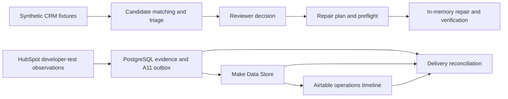

# CRM Data Quality, AI-Assisted Matching & Controlled Repair

A review-first CRM workflow prototype. It identifies potential duplicates, captures reviewer decisions and checks whether a proposed repair can proceed. The customer walkthrough uses synthetic data and runs offline.

## Run the demo

From the repository root with Python 3.13 or newer, install the pinned dependency if needed:

```powershell
python -m pip install -r requirements-m2.txt
```

Once RapidFuzz is installed, run the demo:

```powershell
python -B scripts/demo_controlled_repair.py
```

On Windows, `py -B scripts/demo_controlled_repair.py` also works when the Python launcher is installed. Demo execution uses bundled fixtures and RapidFuzz. It needs no credentials, database, Docker or network connection. Output is JSON on the console.

| Stage | What to look for |
| --- | --- |
| Matching | 57 candidates, including 19 with strong evidence and 38 in the review tier. All require human review. |
| Repair | 31 country-normalization requests. Nine are held for duplicate dependencies and 22 are eligible for mock review. |
| Verification | A simulated repair is verified, duplicate execution is avoided, stale data blocks a write, and conflicting recovery requires review. |
| Delivery | A synthetic uncertain notification stays on hold. |

## Architecture



The upper path is the offline demo. Its reviewer approval is simulated. The lower path summarizes the developer-test observation and delivery audit. A11 notifications carry evidence about an operation and confer no CRM write authority.

## Verification and handoff

```powershell
python -B -m unittest discover -s tests
```

- [Customer case study](docs/32-project-01-case-study-draft.md)
- [Technical delivery and verification](docs/31-a11-public-verification.md)
- [Portfolio demos](https://mahdi-eqbal.github.io/revenue-systems-gtm-engineering-portfolio/projects/crm-data-quality/)
- [Historical prototype milestones](docs/20-portfolio-case-study-and-demo.md)

The A11 audit verified four existing acknowledgments against Make and Airtable. Three observations remain pending and one remains held after an HTTP 401. Migration 014 is installed locally and records the rejection evidence and the decision to close the investigation without replay. Production deployment, commercial impact and live rollback guarantees are outside the demonstrated scope.
